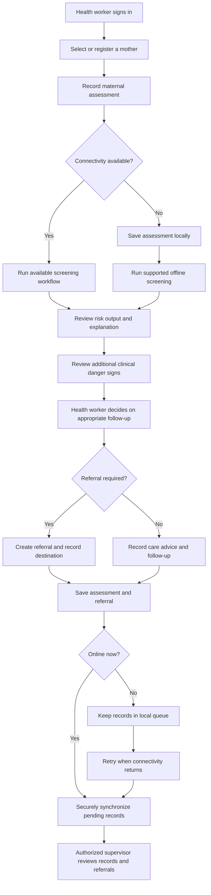

# JanmaSaathi

### Offline-First Maternal Risk Screening & Referral Support

[](https://janma-saathi.vercel.app)
[](https://janma-saathi.vercel.app)
[](https://janma-saathi.vercel.app)

**Live Application URL:** [https://janma-saathi.vercel.app](https://janma-saathi.vercel.app)

JanmaSaathi is a maternal-care support application designed to help
trained village health workers record maternal observations, review
assistive risk-screening information, and support timely referral and
follow-up. It is being developed in alignment with **PS-03: MaaSuraksha
--- Offline-first maternal risk screening**.

> **Clinical safety notice:** JanmaSaathi is an assistive screening and
> care-coordination tool. It is not a diagnostic system and does not
> replace assessment by qualified healthcare professionals. Risk outputs
> must be interpreted by trained health workers under applicable
> clinical protocols.

------------------------------------------------------------------------

## Table of Contents

-   [Live Deployment](#live-deployment)
-   [Problem and Objective](#problem-and-objective)
-   [Core Workflow](#core-workflow)
-   [User Roles](#user-roles)
-   [PS-03 Requirement Mapping](#ps-03-requirement-mapping)
-   [Data and ML Approach](#data-and-ml-approach)
-   [Offline-First and Synchronization
    Design](#offline-first-and-synchronization-design)
-   [Referral Workflow](#referral-workflow)
-   [Privacy and Security](#privacy-and-security)
-   [Technology Stack](#technology-stack)
-   [Run Locally](#run-locally)
-   [Environment Configuration](#environment-configuration)
-   [Testing Checklist](#testing-checklist)
-   [Known Limitations and
    Verification](#known-limitations-and-verification)
-   [Project Structure](#project-structure)

------------------------------------------------------------------------

## Live Deployment

The JanmaSaathi application is actively deployed and accessible at:

🔗 **[https://janma-saathi.vercel.app](https://janma-saathi.vercel.app)**

- **Hosting Platform:** Vercel
- **PWA Installability:** Fully installable as a standalone app on Android (Chrome), iOS (Safari "Add to Home Screen"), and Desktop
- **Trilingual Interface:** English, Hindi (हिन्दी), and Odia (ଓଡ଼ିଆ) with instant live toggling
- **Offline Support:** Tested for full offline assessment capture, local Decision Tree ML risk scoring, and automated sync upon reconnection

------------------------------------------------------------------------

## Problem and Objective

Maternal danger signs may need to be recorded during field visits where
reliable internet access is unavailable. Health workers need a practical
way to capture observations, understand screening outputs, and support
referral without depending on continuous connectivity.

JanmaSaathi aims to provide:

1.  Offline-capable maternal case capture through an Android-friendly
    Progressive Web App (PWA).
2.  Multilingual access in English, Hindi and Odia.
3.  Assistive maternal risk screening with understandable, data-grounded
    explanations.
4.  Later synchronization of locally saved records to an authorized
    supervisor dashboard.
5.  A clear referral and follow-up workflow operated by trained health
    workers.

The application should capture observations such as blood pressure,
haemoglobin, bleeding, swelling and reduced fetal movement, as specified
in PS-03.

## Core Workflow



### Typical field workflow

1.  The health worker authenticates using assigned credentials.
2.  The worker opens an assigned mother's record or registers a new
    mother.
3.  The worker enters available maternal measurements, reported symptoms
    and clinical observations.
4.  The application validates required inputs and runs the supported
    screening process.
5.  The result presents the risk category, relevant contributing
    information and any separately identified danger signs.
6.  The trained health worker reviews the findings and follows the
    applicable clinical protocol.
7.  If needed, the worker creates a referral with the reason, priority,
    destination and follow-up details.
8.  If offline, the assessment and referral are retained locally for
    later synchronization.
9.  When connectivity returns, pending records are uploaded and made
    available to authorized supervisors after server acknowledgement.

------------------------------------------------------------------------

## User Roles

### Mother

The mother-facing experience is intended to support access to pregnancy
information and communication with the assigned health worker. Depending
on the enabled application modules, it may include:

-   Pregnancy journey and appointment information.
-   Wellness and general pregnancy education.
-   Nutrition and self-care information.
-   Health updates and communication with the assigned health worker.
-   Profile and language preferences.

### Health Worker

The health worker is the primary field user and is responsible for
recording observations and acting on the screening workflow.

-   Assigned mother directory.
-   Mother registration and profile access.
-   Maternal assessment entry.
-   Assistive screening result and explanation review.
-   Patient-specific messages and alerts, where enabled.
-   Referral creation and tracking.
-   Follow-up and reporting workflows.

### Medical Officer / Supervisor

The supervisor experience supports oversight of assigned health workers
and synchronized maternal-care records.

-   Assign health workers to villages, hamlets and mothers.
-   View authorized health-worker and maternal records.
-   Review synchronized assessments and screening summaries.
-   Monitor pending referrals and follow-ups.
-   Review referral status and case progress.
-   Identify records that require attention.

Access must be restricted by role, assignment and authorization rules.

------------------------------------------------------------------------

## PS-03 Requirement Mapping

The following table maps the official PS-03 deliverables to the
JanmaSaathi implementation target. A feature should be marked complete
only after it has been demonstrated and tested in the running
application.

  -----------------------------------------------------------------------
  PS-03 requirement       JanmaSaathi             Evidence to demonstrate
                          implementation          
  ----------------------- ----------------------- -----------------------
  Android app or PWA with Installable,            Open the app after
  offline case capture    mobile-responsive PWA   initial caching, switch
                          with local assessment   off the network,
                          storage                 complete and save an
                                                  assessment

  Multilingual or voice   Application-wide        Change language and
  input                   English, Hindi and Odia complete the workflow;
                          support; voice input    demonstrate voice input
                          may be an additional    if implemented
                          option                  

  Risk levels with        Assistive risk          Show a prediction, its
  understandable reasons  screening with          actual contributing
  from entered danger     explanations grounded   features and separately
  signs                   in actual model inputs  handled danger signs
                          and separately          
                          evaluated clinical      
                          observations            

  Later synchronization   Pending local records   Create a record
  to a supervisor         synchronize to the      offline, reconnect,
  dashboard               backend and are exposed verify server
                          to authorized           acknowledgement and
                          supervisors             supervisor visibility

  Clear referral workflow Health worker reviews   Demonstrate referral
  supporting trained      findings and creates a  creation, submission,
  health workers          referral with           acknowledgement and
                          destination and         status tracking
                          follow-up details       
  -----------------------------------------------------------------------

### PS-03 data requirements

-   **Dataset:** UCI Maternal Health Risk CSV, as specified in the
    assignment brief.
-   **Additional cases:** Prepare clearly labelled synthetic cases for
    danger signs not represented in the dataset.
-   **Review focus:** Demonstrate offline entry and later
    synchronization, understandable risk reasons, and a usable referral
    workflow.
-   **Key constraint:** Support trained health workers. The tool must
    not claim to diagnose.

The dataset must not be assumed to contain every observation collected
by the assessment form. Model-supported features and additional clinical
observations must be handled and labelled separately.

------------------------------------------------------------------------

## Data and ML Approach

### Dataset use

The UCI Maternal Health Risk CSV is the specified benchmark dataset for
the ML component. Before training or inference, document and validate:

-   Dataset source and version.
-   Feature names and expected order.
-   Units and valid input ranges.
-   Missing-value handling.
-   Preprocessing steps.
-   Target labels and class mapping.
-   Train/validation/test separation.
-   Evaluation metrics and limitations.

Do not silently substitute synthetic records for the required benchmark
dataset.

### Explainable screening

The screening result should distinguish:

1.  **Model prediction:** Output produced by the trained model using
    only the features it actually supports.
2.  **Model explanation:** A model-appropriate explanation of the actual
    inputs that contributed to the output.
3.  **Additional clinical observations:** Danger signs collected by the
    assessment form but not necessarily represented in the benchmark
    dataset.
4.  **Clinical follow-up:** The action reviewed and selected by the
    trained health worker under applicable protocols.

Do not claim that the ML model evaluated a field that was not part of
its trained feature set. Do not invent feature contributions, confidence
values, medical thresholds or explanations.

### Synthetic danger-sign cases

Create a separate, clearly labelled synthetic test dataset for
additional danger signs missing from the benchmark dataset, such as:

-   Reported bleeding.
-   Swelling.
-   Reduced or absent fetal movement.
-   Other relevant danger-sign observations required by the assessment
    workflow.

Synthetic cases are for development, testing and demonstration. They
must never be presented as real patient records or silently merged into
the benchmark dataset as though they were original observations.

### Clinical safety

-   ML output is assistive screening information, not a diagnosis.
-   A low model-risk output must not override a separately identified
    urgent danger sign.
-   Clinical rules and thresholds must come from approved clinical
    protocols and be reviewed by qualified personnel.
-   The health worker remains responsible for reviewing findings and
    following the appropriate referral protocol.
-   The application must not prescribe medication or replace
    professional care.

------------------------------------------------------------------------

## Offline-First and Synchronization Design

### Offline operation

After the application has been loaded and its required assets cached,
supported field workflows should remain usable without an active network
connection.

The offline implementation should account for:

-   PWA manifest and service-worker caching.
-   Local persistent storage, such as IndexedDB.
-   Offline form validation.
-   Locally available screening logic and model assets, where supported.
-   Local assessment and referral records.
-   A durable queue of pending operations.
-   Recovery after browser closure or device restart.

Offline capability must be tested on a real device with connectivity
disabled. A visual offline indicator alone does not prove offline
functionality.

### Later synchronization

When connectivity returns, pending records should be synchronized
securely.

1.  Identify locally saved records not yet acknowledged by the server.
2.  Upload records with stable unique identifiers.
3.  Prevent duplicate records during retries.
4.  Handle failed requests without deleting local data.
5.  Resolve conflicting updates safely.
6.  Mark a record synchronized only after server acknowledgement.
7.  Make authorized records available in the supervisor dashboard.

An offline referral is a locally recorded referral request until
successfully transmitted and acknowledged. The interface must not imply
that a facility or supervisor has received an offline-only referral.

------------------------------------------------------------------------

## Referral Workflow

1.  Review the mother's recorded assessment and screening information.
2.  Review any separately identified danger signs.
3.  Determine the appropriate next step under the applicable clinical
    protocol.
4.  Create a referral when required.
5.  Record the referral reason, priority, destination facility,
    date/time and responsible health worker.
6.  Save the referral locally if offline.
7.  Synchronize it when connectivity returns.
8.  Track acknowledgement, progress, completion and follow-up.

Suggested referral lifecycle states:

-   Draft
-   Pending synchronization
-   Submitted
-   Acknowledged
-   In progress
-   Completed
-   Follow-up required

Use these states only when their underlying events have actually
occurred. An offline record must not be labelled "Submitted" until the
receiving backend has accepted it.

------------------------------------------------------------------------

## Privacy and Security

Maternal information is sensitive. A production deployment should
implement:

-   Role-based access control for mothers, health workers and
    supervisors.
-   Assignment-based access to maternal records.
-   Secure transport for network requests.
-   Server-side authorization on every protected API.
-   Input validation and safe error handling.
-   Audit records for important assessment and referral actions.
-   Secure handling of authentication tokens.
-   Appropriate protection of locally stored records.
-   A defined retention, backup and deletion policy.
-   No real patient information in public demo data or source-control
    commits.

Use synthetic or properly de-identified data for development and
demonstrations. Do not commit credentials, private keys, production API
tokens or real patient records.

------------------------------------------------------------------------

## Technology Stack

The table below reflects the verified, checked-in architecture of the JanmaSaathi application:

| Layer | Repository Implementation | Details |
|---|---|---|
| **Live Web App** | Vercel Deployment | Hosted and accessible at [https://janma-saathi.vercel.app](https://janma-saathi.vercel.app) |
| **Frontend Framework** | React 19 (`react@^19.0.1`, `react-dom@^19.0.1`) | Functional components, custom hooks, React context architecture |
| **Language & Tooling** | TypeScript 5+ & Vite 8 | Strict typing, esbuild bundling, `@vitejs/plugin-react` |
| **Styling & UI** | Tailwind CSS v4 (`@tailwindcss/vite`) | Modern CSS theme tokens, DM Sans & DM Serif typography, Lucide React icons, Motion animations |
| **PWA & Offline Cache** | `vite-plugin-pwa` + Workbox | Web App Manifest (`manifest.webmanifest`), precaching, standalone display, Android & iOS installability |
| **Local Persistence** | IndexedDB (`JanmaSaathi_OfflineDB_v1`) | 6 dedicated object stores: `assessmentDrafts`, `maternalProfiles`, `healthUpdateDrafts`, `referralDrafts`, `appointmentDrafts`, `messageDrafts` |
| **Backend Server** | Full-Stack Express (`server.ts`) | Node.js Express server mounting Vite middlewares, serving `/api/predict` ML revalidation & `/api/health` probes |
| **Database & Auth** | Google Cloud Firestore & Firebase Auth | Dedicated database `ai-studio-janmasaathi-8e8b2a1f-7b17-42e6-bc8e-284c5c28d2df`, multi-tab persistent cache, Email/Password & Google Sign-In, fine-grained `firestore.rules` |
| **Machine Learning** | Client & Server Decision Tree Engine | Pre-trained Decision Tree model (`model_v1.0.0.json`) benchmarked on UCI Maternal Health Risk dataset (86.8% test accuracy, 0.865 macro F1 score) |
| **Clinical Safety Engine** | Rule-Based Screening (`clinicalScreening.ts`) | Independent screening for maternal emergencies (eclampsia, hemorrhage, severe anemia, fetal distress) ensuring clinical signs are never masked |
| **Explainability** | Decision Path Tracing & Feature Impact | Explicit feature impact analysis (`increases_risk` / `lowers_risk`), exact thresholds, and delta values grounded in clinical measurements |
| **Localization** | Trilingual Engine (English, Hindi, Odia) | Comprehensive static translation dictionaries (`translations.ts`), dynamic runtime localization (`dynamicLocalization.ts`), Odia (୦-୯) and Devanagari (०-९) numeral transliteration |
| **AI Studio Services** | `@google/genai` (Gemini API) | Server-side Gemini integration capability for assistive synthesis |

------------------------------------------------------------------------

## Run Locally

The commands below are a starting point for a Node.js-based frontend.
Confirm the repository's `package.json` scripts and lockfile before
running them. If the project uses a different package manager or a
separate backend, follow the corresponding project configuration.

### Prerequisites

-   Git.
-   Node.js LTS compatible with the project.
-   npm (or the package manager indicated by the repository lockfile).
-   A modern browser such as Chrome.
-   Backend/database credentials if the local application requires a
    remote or locally hosted backend.

### 1. Clone or extract the project

``` bash
git clone <YOUR_REPOSITORY_URL>
cd <PROJECT_DIRECTORY>
```

If using the downloaded source ZIP, extract it and open a terminal in
the extracted project directory.

### 2. Install dependencies

For an npm project:

``` bash
npm install
```

If the repository includes `package-lock.json`, a clean reproducible
install can usually be performed with:

``` bash
npm ci
```

Use the package manager that matches the committed lockfile. Do not mix
npm, pnpm and Yarn lockfiles.

### 3. Configure environment variables

If the project contains an `.env.example` file, copy it to the expected
local environment filename and fill in the required values.

``` bash
cp .env.example .env
```

On Windows Command Prompt:

``` bat
copy .env.example .env
```

Do not invent environment variable names. Use the names documented in
`.env.example` and the actual source code. Never commit a populated
`.env` file containing secrets.

### 4. Start the development server

For projects whose `package.json` defines a `dev` script:

``` bash
npm run dev
```

Open the local URL printed in the terminal. A Vite-based project
commonly uses `http://localhost:5173`, but the actual port may differ.

To inspect available scripts:

``` bash
npm run
```

### 5. Start the backend, if separate

If the repository contains a separate backend service, open another
terminal in that backend directory and follow its own setup
instructions.

Configure the frontend API base URL using the environment variable
actually defined by the project.

The frontend alone may not provide authentication, server-side
persistence, supervisor synchronization or referral delivery if those
functions depend on a separate backend.

### 6. Create a production build

For projects that define a `build` script:

``` bash
npm run build
```

If a `preview` script exists:

``` bash
npm run preview
```

Resolve build errors before treating the application as ready for
deployment.

### 7. Test PWA and offline behaviour

1.  Run the application in a supported browser.
2.  Load it while online so required assets can be cached.
3.  Install it or add it to the device home screen if the browser offers
    that option.
4.  Close and reopen the application.
5.  Disable Wi-Fi and mobile data.
6.  Test the supported offline workflow, including assessment capture
    and local persistence.
7.  Re-enable connectivity.
8.  Verify that pending records synchronize and appear in the authorized
    supervisor view.

Service-worker and install behaviour should be tested using an
appropriate secure context, normally HTTPS or localhost during
development.

------------------------------------------------------------------------

## Environment Configuration

The repository uses the following environment variables (defined in `.env.example`):

| Variable | Purpose | Required / Default |
|---|---|---|
| `GEMINI_API_KEY` | Server-side Gemini API key for assistive clinical features and AI Studio capabilities. | Optional for core ML/PWA workflows; injected automatically in AI Studio. |
| `APP_URL` | Canonical origin / host address of the deployment (e.g. `https://janma-saathi.vercel.app`). | Optional; defaults to current host URL. |
| `PORT` | Local and production Express dev server port. | Default: `3000`. |

> **Note on Firebase configuration:** Firebase project credentials (`outr-janmasaathi`) and Firestore database ID (`ai-studio-janmasaathi-8e8b2a1f-7b17-42e6-bc8e-284c5c28d2df`) are configured via `firebase-applet-config.json` and loaded securely through `src/lib/firebase.ts`. Never commit private service account keys or passwords to version control.

------------------------------------------------------------------------

## Testing Checklist

### PWA and offline capture

-   [ ] Application can be installed or added to the home screen where
    supported.
-   [ ] Required application assets are cached.
-   [ ] Application reopens after initial caching with connectivity
    disabled.
-   [ ] Maternal assessment can be captured offline.
-   [ ] Saved records persist after closing and reopening the
    application.
-   [ ] Failed synchronization does not delete local records.

### Language support

-   [ ] English interface works.
-   [ ] Hindi interface works.
-   [ ] Odia interface works.
-   [ ] Language preference persists as intended.
-   [ ] Required language resources are available offline.

### Screening and explanation

-   [ ] UCI dataset and model feature mapping are verified.
-   [ ] Model inference uses the expected input preprocessing.
-   [ ] Risk output is generated by the actual model.
-   [ ] Explanation is grounded in actual model inputs and supported
    attribution logic.
-   [ ] Additional danger signs are evaluated separately where
    necessary.
-   [ ] No model output is presented as a medical diagnosis.

### Synchronization and supervisor view

-   [ ] Offline records enter a durable pending queue.
-   [ ] Reconnection triggers or permits synchronization.
-   [ ] Server acknowledgement is verified.
-   [ ] Retry does not create duplicate records.
-   [ ] Authorized supervisor can view synchronized records.
-   [ ] Access restrictions are tested.

### Referral

-   [ ] Trained health worker can create a referral.
-   [ ] Referral reason and destination are recorded.
-   [ ] Offline referral is retained locally.
-   [ ] Online submission is acknowledged by the receiving system.
-   [ ] Referral status and follow-up can be tracked.

------------------------------------------------------------------------

## Known Limitations and Verification

This README describes the intended product workflow and the PS-03
acceptance criteria. It does not, by itself, prove that every feature is
implemented or production-ready.

Before claiming PS-03 compliance, verify each item in the running
application and record the test evidence.

In particular, confirm:

-   Actual offline assessment submission and persistence.
-   Actual local ML inference and explanation while offline.
-   Full English, Hindi and Odia coverage.
-   Successful later synchronization to the supervisor dashboard.
-   End-to-end referral submission and tracking.
-   Clinical review of danger-sign rules and translations.
-   Role-based access and protection of maternal records.

Clearly label any incomplete feature as **Planned**, **In progress** or
**Not yet verified** rather than claiming it is complete.

------------------------------------------------------------------------

## Project Structure

The repository is organized as an offline-first Progressive Web Application with a co-located Node.js Express server for local ML revalidation:

``` text
janmasaathi/
├── public/                                  # Static PWA, icons and branding assets
│   ├── assets/                              # Application media and sample assets
│   ├── apple-touch-icon.png                 # iOS home screen touch icon
│   ├── emblem.png                           # National Health Mission / Government emblem
│   ├── favicon.ico                          # Application browser favicon
│   ├── manifest.webmanifest                 # Web App Manifest for mobile installability
│   ├── pwa-192x192.png                      # Standard PWA launcher icon
│   ├── pwa-512x512.png                      # High-resolution splash icon
│   └── pwa-maskable-512x512.png             # Adaptive maskable PWA icon
├── scripts/                                 # Verification, ML training & audit suites
│   ├── testExplainableAiAndScreening.ts     # ML inference and clinical danger-sign verification
│   ├── testOfflineMessaging.ts              # IndexedDB offline chat and sync verification
│   ├── testOfflineSubmissionFlow.ts         # Offline assessment capture & local ML verification
│   ├── train_maternal_models.py             # Python model training script on UCI benchmark dataset
│   ├── trainAndAuditML.ts                   # Decision Tree benchmark & model JSON exporter
│   ├── verifyDynamicLocalizationE2E.ts      # Trilingual E2E localization verification
│   └── verifyTranslationParity.ts           # Translation dictionary audit suite
├── src/                                     # Full-stack frontend source code
│   ├── components/                          # Reusable UI components
│   │   ├── layout/                          # Role-specific layouts & navigation
│   │   │   ├── GlobalHeader.tsx             # Header bar with language, role, and profile
│   │   │   ├── MotherBottomNav.tsx          # Mother tab navigation bar
│   │   │   ├── WorkerBottomNav.tsx          # Health worker tab navigation bar
│   │   │   └── SupervisorBottomNav.tsx      # Medical officer tab navigation bar
│   │   ├── OfflineIndicator.tsx             # Real-time connection status banner & sync counter
│   │   └── PWAInstallButton.tsx             # In-app native PWA install button
│   ├── context/                             # React application state contexts
│   │   ├── AuthContext.tsx                  # Role authentication, Firebase Auth & Google login
│   │   ├── DataContext.tsx                  # Central reactive data store & live Firestore listeners
│   │   └── LanguageContext.tsx              # Trilingual language switcher (EN, HI, OR)
│   ├── data/                                # Central seed and demo roster data
│   │   └── centralDemoData.ts               # Demo users, clinical records & allocations
│   ├── hooks/                               # Custom React hooks
│   │   └── usePWAInstall.ts                 # PWA install prompt event handler
│   ├── i18n/                                # Multilingual translation dictionaries
│   │   └── translations.ts                  # Static translation dictionaries (English, Hindi, Odia)
│   ├── lib/                                 # Core library integrations
│   │   └── firebase.ts                      # Firebase SDK, Firestore persistent cache, Auth, Storage
│   ├── ml/                                  # Machine learning & clinical screening engine
│   │   ├── clinicalScreening.ts             # Clinical danger-sign rule engine
│   │   ├── evaluation_report.json           # UCI benchmark accuracy, F1 & confusion matrix
│   │   ├── mlEngine.ts                      # Offline decision tree inference & explainability
│   │   └── model_v1.0.0.json                # Pre-trained decision tree model artifact
│   ├── screens/                             # Role-based application screens
│   │   ├── auth/                            # Authentication
│   │   │   └── LoginScreen.tsx              # 3-role portal login & Google Sign-In
│   │   ├── mother/                          # Mother experience screens
│   │   │   ├── MotherConnectScreen.tsx      # Offline-first messaging with ASHA worker
│   │   │   ├── MotherHomeScreen.tsx         # Week milestone & danger alerts
│   │   │   ├── MotherJourneyScreen.tsx      # Trimester milestones & visit history
│   │   │   ├── MotherProfileScreen.tsx      # MCP card info & emergency contacts
│   │   │   └── MotherWellnessScreen.tsx     # Nutrition & pregnancy care guidance
│   │   ├── supervisor/                      # Medical Officer / Supervisor screens
│   │   │   ├── SupervisorAssignScreen.tsx   # Worker village/hamlet allocation wizard
│   │   │   ├── SupervisorMoreScreen.tsx     # Administrative tools & status
│   │   │   ├── SupervisorOverviewScreen.tsx # High-risk case monitoring dashboard
│   │   │   ├── SupervisorReferralsScreen.tsx# Referral tracking & status approvals
│   │   │   ├── SupervisorReportsScreen.tsx  # Anemia & gestational health analytics
│   │   │   └── SupervisorWorkersScreen.tsx  # Worker performance & caseload oversight
│   │   └── worker/                          # Health Worker (ASHA / ANM) screens
│   │       ├── WorkerAssessmentResultScreen.tsx # Explainable screening result & referral
│   │       ├── WorkerHomeScreen.tsx         # Field dashboard & pending cases
│   │       ├── WorkerMoreScreen.tsx         # Sync manager & offline diagnostics
│   │       ├── WorkerNewAssessmentScreen.tsx# Vitals entry, danger signs & voice input
│   │       ├── WorkerPatientsScreen.tsx     # Mother roster & registration
│   │       └── WorkerReferralsScreen.tsx    # Facility referral management
│   ├── services/                            # Cloud Firestore & API services
│   │   └── firestoreService.ts              # Real-time listeners & CRUD mutations
│   ├── types/                               # TypeScript domain definitions
│   │   └── index.ts                         # Clinical, user & assessment interfaces
│   ├── utils/                               # Storage, synchronization & localization
│   │   ├── dynamicLocalization.ts           # Runtime translation & script transliteration
│   │   ├── indexedDB.ts                     # Offline IndexedDB object store management
│   │   ├── offlineQueue.ts                  # Durable offline mutation queue
│   │   └── syncManager.ts                   # Background sync orchestrator & auto-triggers
│   ├── App.tsx                              # Root router & role coordinator
│   ├── index.css                            # Tailwind CSS styling & theme definition
│   ├── main.tsx                             # React entry point
│   ├── pwa.ts                               # Service worker registration
│   └── vite-env.d.ts                        # Vite client type declarations
├── .env.example                             # Environment variable template
├── firebase-applet-config.json              # Firebase project configuration
├── firebase-blueprint.json                  # Firestore schema blueprint
├── firestore.rules                          # Role-based Firestore security rules
├── storage.rules                            # Firebase Storage security rules
├── index.html                               # Mobile-first HTML5 entry point
├── metadata.json                            # AI Studio app metadata & capabilities
├── package.json                             # Dependencies & build scripts
├── server.ts                                # Express backend & Vite middleware server
├── tsconfig.json                            # TypeScript compiler configuration
├── vite.config.ts                           # Vite & Workbox PWA configuration
└── README.md                                # Project documentation
```

------------------------------------------------------------------------

## Contributing

1.  Create a feature branch.
2.  Keep changes scoped to the relevant workflow.
3.  Preserve offline behaviour when modifying assessment or referral
    logic.
4.  Add or update tests for new functionality.
5.  Do not include real patient data or credentials in commits.
6.  Update this README when setup steps, environment variables or
    workflows change.

------------------------------------------------------------------------

## Problem Statement Reference

**PS-03 --- MaaSuraksha: Offline-first maternal risk screening**\
Theme: T3 --- Healthcare & Wellbeing

The project requirements documented here are based on the supplied
Hackathon Problem Statement Assignments brief, pages 9--10.

**JanmaSaathi's objective:** Give trained village health workers an
offline-capable tool to record maternal danger signs, understand
assistive screening information and support referral, with later
synchronization to an authorized supervisor dashboard.
